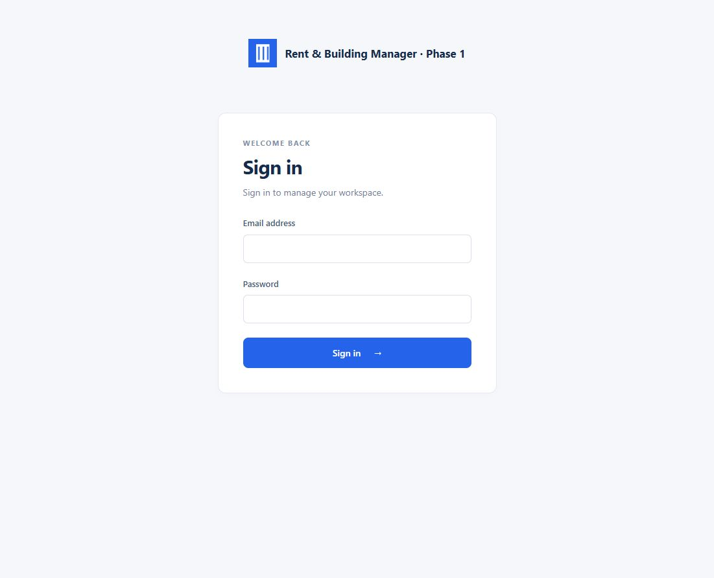

# Phase 1 Report — 2026-10-25

## 1. Summary

Completed the Laravel 12 foundation on phase-1: installer, five-role authentication, owner isolation, layouts and settings.
Built fresh because reference/cheque-studio is absent.
All automated checks pass, with a real MariaDB install and browser checks; user acceptance remains pending.

## 2. Files created or changed, grouped by purpose

- Schema and identities: database/migrations/0001_01_01_000000_create_users_table.php; app/Models/{Owner,User,Setting}.php; database/factories/{OwnerFactory,UserFactory}.php; database/seeders/DatabaseSeeder.php.
- Ownership and roles: app/Enums/Role.php; app/Support/CurrentOwner.php; app/Models/Concerns/BelongsToOwner.php; app/Models/Scopes/OwnerScope.php; app/Http/Middleware/{EnsureInstalled,RequireRole,ApplyBranding}.php; app/Providers/AppServiceProvider.php.
- Installer, authentication and settings: app/Services/Installation.php; app/Http/Controllers/{InstallController,AuthController,SettingsController}.php; app/Http/Requests/{InstallRequest,LoginRequest,SettingsRequest,BrandingRequest,LocaleRequest}.php; routes/web.php; bootstrap/app.php.
- Configuration: config/{app,filesystems,session,install,product}.php; .env.example; .gitignore.
- UI: resources/views/layouts/{admin,guest}.blade.php; resources/views/auth/login.blade.php; resources/views/settings/{owner,branding}.blade.php; resources/views/{dashboard,install}.blade.php; components/field.blade.php; partials/messages.blade.php; resources/css/app.css; resources/js/app.js; lang/en/{app,auth,passwords,pagination,validation}.php; package.json; package-lock.json; public/build/.
- Verification and handover: tests/Feature/FoundationTest.php; tests/MySql/InstallerMySqlTest.php; docs/screenshots/phase-1-login.png; README.md; docs/DECISIONS.md; PROGRESS.md; this report.
- Removed the framework welcome view and trivial example tests. Kept AGENTS.md and docs/DATA_MODEL.md unchanged. composer.json and phpunit.xml already supplied the requested test script and SQLite setup.

## 3. Commands run and results

| Command/check | Result |
| --- | --- |
| git checkout -b phase-1 | Created branch |
| composer install --no-interaction | Passed; lockfile dependencies already installed |
| php artisan migrate:fresh --force | Passed on explicitly selected in-memory SQLite, without resetting the browser database |
| composer test / php artisan test | Final default suite: 23 passed, 139 assertions |
| php artisan test tests/MySql --group=mysql | 1 passed, 10 assertions; fresh random database created and removed by the test |
| php vendor/bin/pint | Passed after formatting |
| php vendor/bin/pint --test | Passed |
| npm install alpinejs | Passed; 0 npm vulnerabilities reported |
| npm run build | Passed; compiled CSS/JS and manifest present |
| php artisan route:list --except-vendor | 15 expected application routes |
| rg source scan for cheque, dd(), dump(), console.log | No matches in app/resources/routes/lang/database/config |
| git diff --check | Passed |

Initial checks caught and fixed middleware ordering and schema-qualified table listing. The browser MariaDB check additionally caught cross-database schema enumeration; the installer now inspects only the selected schema. No known failing tests remain.

Browser evidence on PHP 8.2.12 / MariaDB 10.4.32:

- No .env: requirements rendered and all checks passed.
- Invalid database user: retryable error; confirmed .env did not exist afterwards.
- Deliberate stale configuration and blank APP_KEY: installer remained accessible and installation succeeded.
- Owner account created; login redirected to /admin, logout returned to login.
- JPY with 0 decimals and Asia/Dhaka saved successfully.
- Tenant login redirected to /portal; visiting /admin displayed 403.
- Super admin redirected to /super-admin; global product name and uploaded logo appeared in sidebar, login and browser title.
- Visiting /install after completion displayed 403.
- Logo isolation, guessed paths, account inactivity, all role landing routes and cross-owner settings were additionally exercised in automated tests.

## 4. Assumptions and decisions

Recorded in docs/DECISIONS.md.

- User-approved distinction: super admins alone control global branding in a separate area; owners manage their own company/currency settings.
- Schema uses only the listed business-table columns; no implicit business timestamps or remember_token. users.tenant_id has no foreign key yet.
- Authentication identities must be resolved before an owner exists. User/Owner are identity/scope roots; scoped business settings use BelongsToOwner. Super admin has no automatic owner-scope bypass.
- Private owner logos are served through an authenticated current-owner route; global logo is intentionally public.
- English only; installed-locale switcher; no money arithmetic or later-phase features.
- SMTP is configured without sending email. File sessions/cache and sync queue avoid permanent workers.
- Existing application .env was preserved at storage/app/phase1-original-env.backup before local installer testing. Current .env points to the dedicated browser-test database.

## 5. Not done or skipped

- Reference porting: source folder absent; built fresh under the explicit fallback.
- SMTP delivery, public/shared-hosting deployment, MySQL 5.7 and MariaDB 10.3 version-specific runs: not tested here; actual database evidence is MariaDB 10.4.32.
- Property, tenant records, leases, billing, reports and notifications: excluded by Phase 1 scope. The tenant account is an authentication fixture, with tenant_id null.
- No user-management UI or default production super-admin credentials.
- No merge/tag: user owns the acceptance gate.

## 6. How to test by hand

The local server is running at http://127.0.0.1:8000/login with database rent_manager_phase1_20261025. Temporary local-only credentials are supplied in the chat Phase Report.

1. Sign in as owner@rent-manager.test. Confirm /admin. Open Settings, change the company name and currency to JPY/0, save, reload and confirm persistence. Upload a PNG logo and confirm it appears in the sidebar.
2. Sign out. Open /admin and confirm redirection to login.
3. Sign in as tenant@rent-manager.test. Confirm /portal. Enter /admin in the address bar and confirm 403.
4. Sign in as manager@rent-manager.test or accountant@rent-manager.test. Confirm /admin, no settings link, and 403 at /admin/settings.
5. Sign in as super_admin@rent-manager.test. Open Global branding, change product name/colour/logo, save, then sign out. Verify the login name/logo/title.
6. Visit /install and confirm 403.
7. Run the default and separate MySQL tests above to check schema and owner isolation. For a fresh browser installer run, use a separate deployment and empty database as described in README.md.

